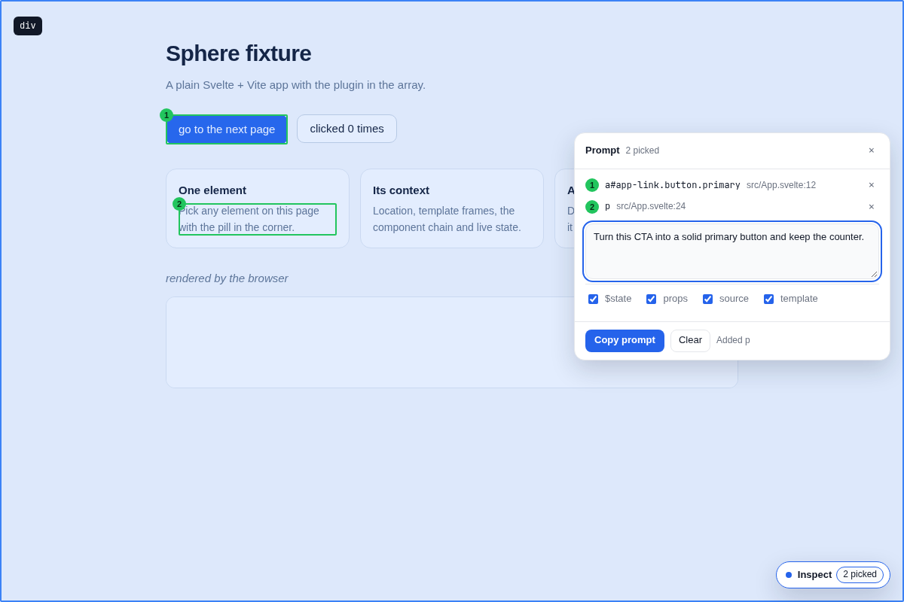
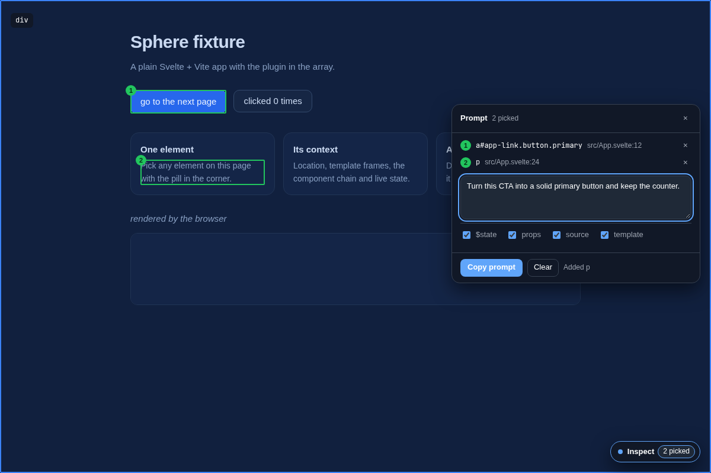

# Sphere

**Turn what you see in a running Svelte app into precise context for a coding agent.**

Sphere is a dev-only Vite plugin for Svelte/SvelteKit. It puts a small control in your
app, lets you pick elements on the page, and copies a markdown prompt with everything an
agent needs to act on that part of the UI: the element's source location, the Svelte
template context it sits in, the component instance chain with props and live `$state`,
and a numbered source window — plus the instructions you typed.

Nothing leaves the browser: the payload goes to your clipboard.

## 60-second quickstart

```bash
npm install --save-dev sphere-plugin
```

```ts
// vite.config.ts
import { sveltekit } from '@sveltejs/kit/vite'
import { sphere } from 'sphere-plugin'

export default defineConfig({
  plugins: [sphere(), sveltekit()], // Sphere first, always
})
```

A plain Svelte + Vite app is the same with `svelte()` instead of `sveltekit()`. Requirements:
Node ≥ 22, Vite ≥ 8, Svelte 5; SvelteKit 2 and 3 are supported (Kit 3 is verified end to end in CI,
Kit 2's template shape is covered by the transform's tests).

1. Start the dev server and click **Inspect** in the bottom-right pill.
2. Click the elements you want to change — one, two, ten. Each gets a numbered outline.
3. Type what you want done in the panel.
4. **Copy prompt**, paste it into your agent.

`Escape` leaves picking, the count chip opens and closes the panel, and the pill remembers where
you dragged it.

### Match your design system

The overlay is self-contained by default. To make it follow the site — Carbon, Tailwind, or your
own tokens — map values, with no framework dependency and no CSS import:

```css
/* in the app's global styles */
:root {
  --sphere-theme-bg: var(--cds-background);
  --sphere-theme-fg: var(--cds-text-primary);
  --sphere-theme-accent: var(--cds-link-primary);
}
```

Or from the plugin when the page exposes nothing reusable:

```ts
sphere({ theme: { mode: 'auto', tokens: { accent: 'var(--color-brand)', radius: '4px' } } })
```

Only `--sphere-theme-*` values cross the shadow boundary, so the page cannot restyle the tool and
the tool cannot restyle the page. `mode: 'auto'` follows the OS, `light`/`dark` force the built-in
palette. Token table and Tailwind/Carbon recipes: [`docs/13-theming.md`](docs/13-theming.md).

While picking, keys work too — the answer to "the thing I want is behind this element":
`w`/`↑` parent, `s`/`↓` first child, `a`/`←` previous sibling, `d`/`→` next sibling, `Enter` or
`Space` to pick the outlined element, `Shift+Enter` to pick it and stop, `p` to pin the outline while
the pointer travels, `Backspace` to remove the last pick, `c` to copy, `?` for the whole list. They
work from the moment picking starts, and a navigation key locks the outline so a click confirms what
is outlined rather than what is under the pointer. Typing in the panel is typing; `Escape` closes the
shortcut list or the panel, and leaves picking.

| Light | Dark |
|---|---|
|  |  |

## Privacy and security

- **Dev server only.** Every plugin is `apply: 'serve'`. A production build cannot contain Sphere:
  CI builds a fixture and greps the output (`test/prod-noop.test.ts`).
- **Off is off.** With `sphere({ enabled: false })` the served Svelte client module is the upstream
  one — no wrapper, no instrumentation, no branch in a hot path.
- **Clipboard, not network.** The prompt is the only output; there is no endpoint, no upload, no
  telemetry, no account. Absolute paths are relativised before anything reaches the panel or the
  clipboard, and rendered text is never used as identity.
- **What is stored:** two UI preferences in `localStorage` (`sphere:control`, `sphere:options`).
  Picks, instructions and prompts are session-only and never persisted.
- **What is read:** the source files behind the elements you pick, through Vite's `/@fs` (bounded
  by `server.fs.allow`), and only when a pick needs a location verified or a source window.

## What it is not

- Not a devtools panel or a replacement for one. It is a *prompt builder*: pick → describe → copy.
- Not a browser extension. It is a Vite plugin, dev server only.
- Not a telemetry or analytics product: no network, no accounts, no upload.
- Not framework-agnostic yet. v1 is Svelte 5 / SvelteKit; the adapter seam exists in the
  architecture but is not a v1 promise.

## Development

```bash
npm install
npm --prefix fixtures/kit install    # SvelteKit fixture (optional locally, installed in CI)

npm run dev       # fixtures/plain on http://localhost:5201
npm run check     # lint, format, typecheck (tsc + svelte-check), unit + harness, build
npm run e2e       # picking, clipboard, location, base path, a11y, panel, theme — needs Chromium once:
                  #   npx playwright install chromium
```

| What | Command |
|---|---|
| Golden prompt / doc examples | `npm run golden`, `npm run docs:example`; CI fails on a diff (`npm run check:generated`) |
| README screenshots | `node scripts/screenshots/sphere.mjs` (privacy scan included) |
| Package shape | `npm run pkg:check` (`publint` + `attw` on the packed tarball) |

`fixtures/plain` is a plain Vite + Svelte app; `fixtures/kit` is a SvelteKit app that consumes the
built package through a `file:` link, so the injection test runs against the artifact a user
installs.

The specs in `docs/` are normative; start with [`docs/README.md`](docs/README.md). Contribution
conventions (docs first, conventional commits, tests with the behaviour) are in
[`AGENTS.md`](AGENTS.md).

## Principles

1. **Dev-only by construction.** Every piece is `apply: 'serve'`; a production build cannot
   contain it, and CI proves that.
2. **Opt-in and free when off.** With the option off, the served Svelte client module is the
   upstream one — no wrapper, no instrumentation, no branch in a hot path.
3. **Honest context.** A line number is either verified against the element's own markup or
   labelled as the enclosing element. A value is either the real value or visibly summarised.
4. **Bounded work.** Inspecting one element has a fixed budget (nodes, characters, instances),
   because it runs inside a click handler.
5. **Clipboard, not network.** The only output channel is the user's clipboard.
6. **Test the hard parts in a browser.** Hydration, event swallowing and base paths cannot be
   proven in jsdom.

## Name

**SPHERE** — *Svelte Prompt Helper: Element Region Explorer* — the sphere of context around a piece
of UI. The package is **`sphere-plugin`**, which is what a project adds; the plugin factory is
`sphere()`. See `docs/decisions/0009-name-and-package.md`.
